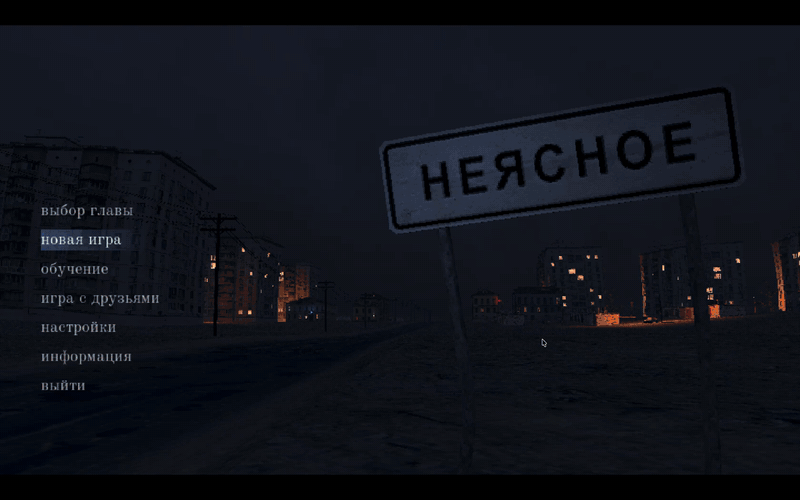

# Неясное: кооп и чат

Фанатский мод для [«Неясного»](https://store.steampowered.com/search/?term=Неясное): совместная игра с друзьями через Steam и чат. Файлы игры не меняются — мод подключается рядом с игрой и удаляется одним файлом.

> Мод неофициальный и не связан с разработчиками игры. Это ранняя версия: если что-то сломалось, создайте [Issue](../../issues).

## Скачать
Готовые архивы — в разделе [Releases](../../releases/latest). Мод нужен **всем** игрокам.

## Установка
**Windows**
1. Распакуйте `neyasnoe-coop-…-windows.zip` прямо в папку игры, рядом с `neyasnoe.exe`
   (Steam → «Неясное» → Управление → Просмотреть локальные файлы).
2. Запустите `install_coop.bat`.

Удалить: `uninstall_coop.bat` или просто удалить `override.cfg` из папки игры.

**macOS**
1. Распакуйте `neyasnoe-coop-…-macos.zip` в любую папку.
2. Запустите `install_coop.command`. Если macOS не даёт открыть файл: правый клик → «Открыть».
   Если игра стоит не в стандартной папке Steam, установщик попросит перетащить `neyasnoe.app` в окно.

Удалить: `uninstall_coop.command`.

## Как играть
Главное меню → **«игра с друзьями»**:
1. **создать игру** → персонаж (24 жителя из игры, среди них Илья) → глава (из уже открытых) → **создать лобби**.
2. В лобби: карточки игроков, чат, **пригласить друзей** — список друзей Steam прямо в игре.
3. Друзья жмут **«я готов»**, хост — **«начать игру»**: глава загружается у всех. Опоздавшие загружают её при входе.

**присоединиться к другу** — список лобби друзей, которые сейчас в игре. Приглашение из Steam тоже работает.

В игре: **Enter** — чат, **F9** — пригласить друга (или создать лобби прямо на текущем уровне), **F10** — выйти из лобби.

## Машины
Подойдите к машине и нажмите **E**, чтобы сесть. Подходят машины городского потока, стоящие машины с отдельными колёсами и машины, поставленные по **F1** (перед вами появляется машина из игры, модель меняется по кругу). Сюжетный транспорт мод не трогает.

За рулём: **W/S** — газ и тормоз (на месте — задний ход), **A/D** — руль, **пробел** — ручник, **мышь** — оглядеться, **N** / **L** — следующий / предыдущий трек (музыка из машин игры, друзья слышат то же), **E** — выйти. Упавшая с карты или перевернувшаяся машина возвращается на дорогу, где была пару секунд назад.

Сверху по центру появляются короткие уведомления: о машинах, лобби и читах игры (F11 — читы, F3 — полёт, F4 — сквозь стены). На Mac F-клавиши нажимаются с **fn**.

## Что синхронизируется
- Позиция, поворот, ходьба и скин других игроков (15 раз в секунду), имя над головой.
- Чат через лобби Steam.
- Машины: та, в которой игрок едет (вместо жителя — машина, над ней имя), поставленные по F1 и брошенные. Машины друзей — копии без столкновений: сквозь них можно проехать. Если друг взял стоящую машину, у вас она тоже уезжает с места.

Пока **не** синхронизируются NPC, двери, предметы и сюжет — у каждого свой мир. Для голоса используйте голосовой чат Steam.

## Как это устроено
Игра собрана на Godot 3.4 со встроенным GodotSteam. Godot читает `override.cfg` рядом с исполняемым файлом — в нём одна строка, добавляющая автозагрузку `user://mods/coop.gd`. Скрипты мода лежат в папке данных игры:
- Windows: `%APPDATA%\Godot\app_userdata\Neyasnoe\mods\`
- macOS: `~/Library/Application Support/Godot/app_userdata/Neyasnoe/mods/`

Сеть — лобби и P2P Steam через ретрансляторы, IP и порты не нужны.

| Файл | Что делает |
|---|---|
| `mod/coop.gd` | ядро: лобби, P2P, синхронизация, горячие клавиши |
| `mod/coop_menu.gd` | меню «игра с друзьями»: персонаж → глава → лобби |
| `mod/coop_friends.gd` | окно приглашения друзей |
| `mod/coop_chat.gd` | чат в игре |
| `mod/coop_avatar.gd`, `mod/coop_skins.gd` | аватары других игроков и список скинов |
| `mod/coop_ui.gd` | общий стиль интерфейса |
| `mod/coop_car.gd` | машины: сесть, ехать, камера, F1 |
| `mod/coop_parked.gd` | стоящие машины уровня → машины с физикой |
| `mod/coop_toast.gd` | уведомления сверху по центру |
| `mod/coop_ghost_car.gd` | машина другого игрока: повторяет присланное движение |
| `mod/coop_radio.gd` | музыка в машине: треки, переключение, номер трека для друзей |

Логи: macOS — `~/Library/Application Support/Godot/app_userdata/Neyasnoe/logs/godot.log`, Windows — `%APPDATA%\Godot\app_userdata\Neyasnoe\logs\godot.log`. Лог пишется при обычном выходе из игры.

Сборка архивов для релиза: `./make_release.sh 0.3` → `dist/`.

## Лицензия
Код мода — [MIT](LICENSE). Игра «Неясное» и все её ресурсы принадлежат их авторам; в репозитории нет файлов игры.
